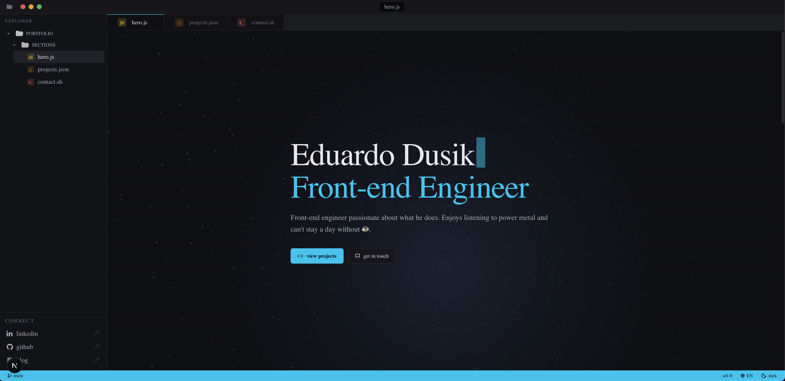

# Portfolio — Eduardo Dusik

Personal portfolio site focused on front-end: an IDE-like experience, themes, internationalization, and projects pulled from GitHub.

[](https://nextjs.org/)
[](https://react.dev/)
[](https://www.typescriptlang.org/)
[](https://yarnpkg.com/)



## Highlights

- IDE-inspired interface
- Light and dark theme (persisted in the browser)
- Content in **Portuguese** and **English**
- Repository list via the [public GitHub API](https://docs.github.com/en/rest) (user `EDusik`; no token required)
- Local project fallback if the API fails or returns empty
- 3D scene with **Three.js** (**React Three Fiber** + **Drei**)
- **Sass** styling and design tokens under `src/styles/`

## Tech stack

| Layer      | Choice                                                                                                                                                             |
| ---------- | ------------------------------------------------------------------------------------------------------------------------------------------------------------------ |
| Framework  | [Next.js](https://nextjs.org/) 15 (App Router, RSC where applicable)                                                                                               |
| Language   | [TypeScript](https://www.typescriptlang.org/) 5                                                                                                                    |
| UI         | [React](https://react.dev/) 19                                                                                                                                     |
| Styling    | [Sass](https://sass-lang.com/) (SCSS), variables in `src/styles/tokens/`                                                                                           |
| 3D / WebGL | [Three.js](https://threejs.org/), [React Three Fiber](https://docs.pmnd.rs/react-three-fiber/getting-started/introduction), [Drei](https://github.com/pmndrs/drei) |
| Typography | `next/font` (Inter, JetBrains Mono)                                                                                                                                |
| Tooling    | ESLint 9, Stylelint 17, Prettier 3; Husky + lint-staged + Commitlint in the local workflow                                                                         |

## Libraries

### Runtime (`dependencies`)

| Package                                                                                                 | Role                                                        |
| ------------------------------------------------------------------------------------------------------- | ----------------------------------------------------------- |
| [`next`](https://www.npmjs.com/package/next)                                                            | Routing, build, SSR/RSC, metadata                           |
| [`react`](https://www.npmjs.com/package/react) / [`react-dom`](https://www.npmjs.com/package/react-dom) | UI and hydration                                            |
| [`three`](https://www.npmjs.com/package/three)                                                          | Scene and WebGL rendering                                   |
| [`@react-three/fiber`](https://www.npmjs.com/package/@react-three/fiber)                                | React render tree over Three.js                             |
| [`@react-three/drei`](https://www.npmjs.com/package/@react-three/drei)                                  | 3D helpers (pmndrs community utilities)                     |
| [`clsx`](https://www.npmjs.com/package/clsx)                                                            | Conditional CSS classes (used with `cn()` in `@/lib/utils`) |
| [`node-emoji`](https://www.npmjs.com/package/node-emoji)                                                | `:shortcode:` expansion for descriptions from GitHub        |

### Development (`devDependencies`)

| Package                                                                                                                                                                                                                                                          | Role                            |
| ---------------------------------------------------------------------------------------------------------------------------------------------------------------------------------------------------------------------------------------------------------------- | ------------------------------- |
| [`typescript`](https://www.npmjs.com/package/typescript)                                                                                                                                                                                                         | Static typing                   |
| [`sass`](https://www.npmjs.com/package/sass)                                                                                                                                                                                                                     | SCSS compilation                |
| [`eslint`](https://www.npmjs.com/package/eslint), [`eslint-config-next`](https://www.npmjs.com/package/eslint-config-next), [`eslint-config-prettier`](https://www.npmjs.com/package/eslint-config-prettier)                                                     | JS/TS linting aligned with Next |
| [`@eslint/eslintrc`](https://www.npmjs.com/package/@eslint/eslintrc)                                                                                                                                                                                             | Flat ESLint config              |
| [`stylelint`](https://www.npmjs.com/package/stylelint), [`stylelint-config-prettier-scss`](https://www.npmjs.com/package/stylelint-config-prettier-scss), [`stylelint-config-recommended-scss`](https://www.npmjs.com/package/stylelint-config-recommended-scss) | CSS/SCSS linting                |
| [`prettier`](https://www.npmjs.com/package/prettier)                                                                                                                                                                                                             | Formatting                      |
| [`postcss`](https://www.npmjs.com/package/postcss)                                                                                                                                                                                                               | CSS pipeline (used by Next)     |
| [`@types/node`](https://www.npmjs.com/package/@types/node), [`@types/react`](https://www.npmjs.com/package/@types/react), [`@types/react-dom`](https://www.npmjs.com/package/@types/react-dom), [`@types/three`](https://www.npmjs.com/package/@types/three)     | TypeScript types                |
| [`husky`](https://www.npmjs.com/package/husky)                                                                                                                                                                                                                   | Git hooks                       |
| [`lint-staged`](https://www.npmjs.com/package/lint-staged)                                                                                                                                                                                                       | Lint staged files               |
| [`@commitlint/cli`](https://www.npmjs.com/package/@commitlint/cli), [`@commitlint/config-conventional`](https://www.npmjs.com/package/@commitlint/config-conventional)                                                                                           | Conventional commit messages    |

Pinned versions: see [`package.json`](package.json) and [`yarn.lock`](yarn.lock).

## Prerequisites

- [Node.js](https://nodejs.org/) **20+** (matches the project toolchain)

## Installation and usage

```bash
yarn install
yarn dev
```

Open [http://localhost:3000](http://localhost:3000).

Production build and local server:

```bash
yarn build
yarn start
```

## Scripts

| Script              | Description                 |
| ------------------- | --------------------------- |
| `yarn dev`          | Development server          |
| `yarn build`        | Production build            |
| `yarn start`        | Serve the production build  |
| `yarn lint`         | ESLint + Stylelint          |
| `yarn lint:fix`     | Auto-fix what the tools can |
| `yarn format`       | Prettier (write)            |
| `yarn format:check` | Prettier (check)            |
| `yarn type-check`   | `tsc --noEmit`              |

The npm/yarn `prepare` script installs **Husky** hooks when a `.git` directory exists.

## Environment variables

| Variable               | Required | Description                                                                                                                                                                                      |
| ---------------------- | -------- | ------------------------------------------------------------------------------------------------------------------------------------------------------------------------------------------------ |
| `NEXT_PUBLIC_SITE_URL` | No       | Canonical site URL (Open Graph / `metadataBase`). Example: `https://your-domain.com`. If missing or invalid, the code falls back to `http://localhost:3000` — set your public URL in production. |

The home page (`src/app/page.tsx`) calls `fetchRepos()` in `src/lib/github.ts`, which uses the public API; on failure it uses the fallback list defined in the same file.

## Repository layout

Root overview (excluding `node_modules` / `.next`):

```
.
├── .husky/                 # Git hooks (e.g. pre-commit, commit-msg)
├── public/
│   └── static/             # favicon, PWA manifest, icons
├── src/
│   ├── app/                # App Router: layout, home page, icon.svg
│   ├── components/
│   │   ├── AppProviders/   # Provider composition
│   │   ├── ContactPage/    # “Contact” panel + terminal
│   │   ├── Editor/         # Main editor-like area
│   │   ├── Hero/           # Hero block + 3D scene (HeroScene)
│   │   ├── HomePage/
│   │   ├── Ide/            # IDE shell (home composition)
│   │   ├── ProjectsPage/
│   │   ├── Sidebar/
│   │   ├── SiteHead/       # Metadata (metadata/)
│   │   ├── Statusbar/
│   │   ├── Topbar/
│   │   └── shared/         # Reusable UI (Tabs, ProjectCard, SvgIcons, …)
│   ├── contexts/           # I18nContext, TabsContext, ThemeContext
│   ├── hooks/              # useMediaQuery, useScrollSpy, …
│   ├── lib/
│   │   ├── constants/      # Sections, virtual files, language colors, …
│   │   ├── i18n/           # Dictionaries and types
│   │   ├── github.ts       # Repository fetch
│   │   └── utils.ts        # cn(), helpers
│   └── styles/             # SCSS entry (index), globals, tokens, partials, mixins
├── CLAUDE.md
├── eslint.config.mjs
├── next.config.mjs
├── package.json
├── stylelint.config.mjs
├── tsconfig.json
└── yarn.lock
```

Code conventions, imports, and SCSS: [CLAUDE.md](CLAUDE.md) (mirrored in [.cursor/rules/claude-conventions.mdc](.cursor/rules/claude-conventions.mdc)).

## Deploy

Works on [Vercel](https://vercel.com/) or any environment that runs **Node** for Next.js apps. In production, set `NEXT_PUBLIC_SITE_URL` to your public URL for correct metadata and social sharing.
